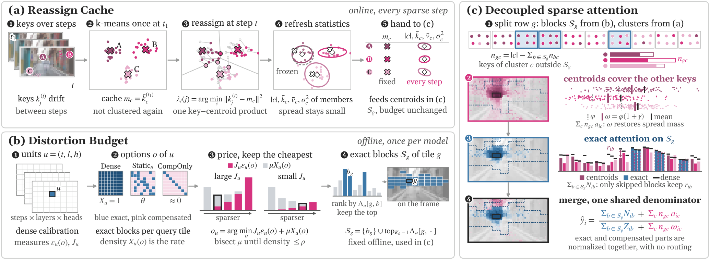

<h1 align="center">DecoupAttn</h1>

<h3 align="center">Decoupled Sparse Attention for Training-Free Acceleration of Video Diffusion</h3>

<p align="center">
  <a href="https://arxiv.org/abs/2611.05917v1"></a>
  <a href="https://huggingface.co/datasets/LLKLL/DecoupAttn-plans"></a>
</p>

<p align="center">
  
</p>

## Overview

Sparse attention accelerates video diffusion transformers by computing a few attention blocks exactly and compensating
for the rest. However, existing sparse attention still faces key challenges, including *identification overhead* from
finding critical blocks at every denoising step, *suboptimal budget allocation* that sets sparsity budgets uniformly or
by local metrics, and *cross-step error accumulation* as reused masks or clusters go stale. Observing that the errors
left on skipped blocks partially cancel each other once every key is compensated, we propose DecoupAttn, a new paradigm
of decoupled sparse attention: semantic clusters compensate every key, and exact attention corrects their error on a few
blocks fixed once offline by position. To support this paradigm, we introduce Distortion Budget, a rate–distortion
objective for budget allocation that places exact computation across denoising steps, layers, and heads where it removes
the most distortion that compensation leaves in the final latent. Built on this budget, we further propose Reassign
Cache, in which each step reassigns the drifting keys to cached centroids and refreshes compensation while the budgeted
blocks stay fixed. Moreover, DecoupAttn is training-free: a few calibration clips compile one plan offline, and
inference runs standard block-sparse kernels with one fused compensation kernel.

## Installation

Linux, NVIDIA Hopper GPU, Python 3.10+, PyTorch 2.5+ with CUDA, Triton 3.1+, FlashInfer 0.2.10,
FlashAttention-3 (`flash_attn_interface`), `ffmpeg`.

```bash
pip install -e ".[kernels,eval,models]"
```

## Downloads

```bash
export DECOUPATTN_DATA_ROOT=/path/to/data
python scripts/fetch_models.py --model cp25      # or --model all
python scripts/fetch_baselines.py
python scripts/build_prompts.py
python scripts/convert_hunyuan_transformer.py    # once, for hy
```

- Models: `cp1`, `cp25`, `wan21`, `wan22`, `hy`, `nano`, `t25`, `dr`, `alaya`, `unirelight`. Gated Cosmos checkpoints
  need their license accepted on the model page and `hf auth login`.
- Each model runs in the environment of its official code (Wan2.1 / Wan2.2: Diffusers 0.34; Cosmos3-Nano: Diffusers 0.41).
- `cp1`, `t25`, `dr`, `alaya` and `unirelight` read their clips from `clips/<clip>/` under the data root; the clips are
  not included.
- Precomputed plan files are on [Hugging Face](https://huggingface.co/datasets/LLKLL/DecoupAttn-plans); `calibrate`
  can also build them.

## Run

```bash
python -m decoupattn calibrate --model cp25 --run-dir runs/cp25            # writes runs/cp25/plan.npz
python -m decoupattn generate  --model cp25 --run-dir runs/cp25 --dense    # dense reference
python -m decoupattn generate  --model cp25 --run-dir runs/cp25
python -m decoupattn evaluate  --model cp25 --run-dir runs/cp25
python -m decoupattn time      --model cp25 --run-dir runs/cp25
```

`python -m decoupattn <command> --help` lists the options.

## Tables

```bash
bash scripts/table1.sh cp25 runs     # after calibrate; "all" for every model
bash scripts/table2.sh cp25 runs
python -m decoupattn table1 --model all --from-reference --check    # from data/table1/reference, no GPU
python -m decoupattn table2 --model all --from-reference --check
```

`scripts/table1.sh` runs each baseline with the interpreter in its variable (default `python`):

| Baseline | Environment | Variable |
| --- | --- | --- |
| CalibAtt | the `setup.sh` of ml-calibatt | `PY_CALIBATT` |
| SVOO | FlashInfer 0.6.11 | `PY_SVOO` |
| SVG2, SVG-EAR | FlashInfer 0.2.10 | `PY_SVG` |
| Sol-Attn, PISA | Triton ≥ 3.6; `TORCHDYNAMO_DISABLE=1` on the Cosmos models | `PY_SOLPISA` |
| SparsePR | FlashInfer 0.6.2 | `PY_SPARSEPR` |

Each environment also needs this package (`pip install -e ".[eval]"`) and the model's official code.
